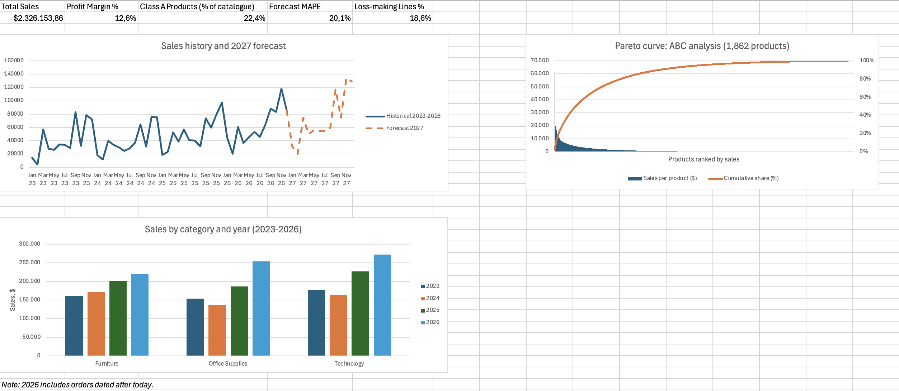
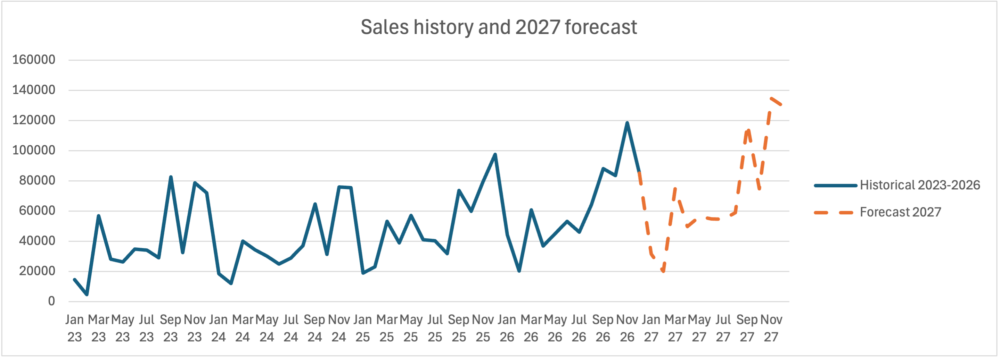
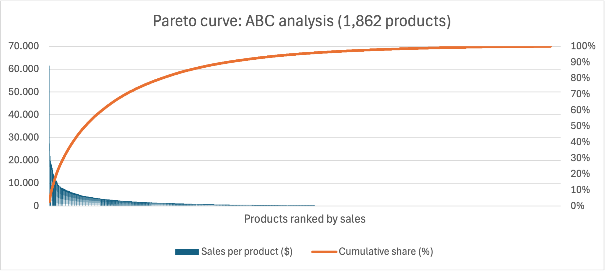
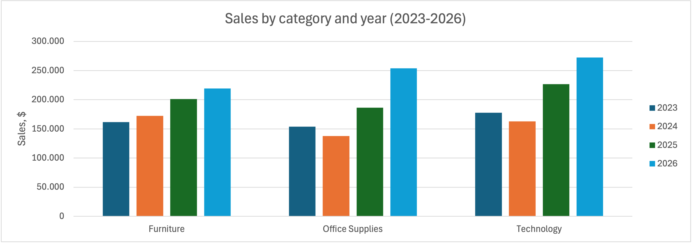

# Retail Sales Analysis in Excel: ABC, Seasonality, Promotions and Demand Forecast

An Excel-only analysis of a retail sales dataset (10,192 order lines, 2023–2026) that answers typical **category management** and **demand planning** questions: which products drive revenue, how sales behave across the year, which categories and discounts destroy margin, and how well a simple forecast works.

> **Data declaration.** The dataset is a *demonstration* dataset (a re-upload of Tableau's "Sample Superstore"), **not real transactions**. See [Data](#data) for the evidence and for what is data versus assumption.



## Key findings

| Question | Result |
|---|---|
| **ABC analysis** | 417 of 1,862 products (22.4%) generate 80% of sales. Class B: 491 products (15%). Class C: 954 products (5%). |
| **Seasonality** | Seasonal index (average of month ÷ yearly average, 2023–2025): highest in Dec (1.86), Nov (1.80), Sep (1.70); lowest in Feb (0.29) and Jan (0.40). |
| **Categories** | Technology and Office Supplies earn a profit margin of about 17%; Furniture only 2.6%. Tables (−8.5%) and Bookcases (−3.1%) lose money. |
| **Promotions** | Lines discounted by more than 20% have a profit margin of **−37.3%** (−$136,008.63) and no higher quantity per line (3.86 vs 3.81 without discount). |
| **Forecast** | A deseasonalised linear trend has the lowest error on 2026: MAPE **20.1%**, against 24.4% for the seasonal naïve baseline. |

Total sales: **$2,326,153.86** · total profit: **$292,273.46** (margin 12.6%) · loss-making lines: 18.6%.

## Business questions

1. **ABC analysis:** which few products generate most of the revenue?
2. **Seasonality and trend:** how do sales change by month and quarter?
3. **Category performance:** revenue, margin and growth.
4. **Promotions:** what happens to margin and volume at different discount levels?
5. **Demand forecast:** a simple monthly forecast, with error measured by MAPE.

## Data

- **Source:** [Superstore Sales Dataset](https://www.kaggle.com/datasets/himanshuuike/superstore-sales-dataset) on Kaggle (Himanshu Uike), licence **CC0**. It is derived from Tableau's *Sample Superstore*.
- **Size:** 10,194 rows × 21 columns in the file, 10,192 rows after cleaning. Order dates run from 2023-01-03 to 2026-12-30.
- **Currency:** not stated by the source. I assume US dollars.
- **Countries:** the file includes 199 Canadian order lines (200 before cleaning).

**Why I treat it as demonstration data (evidence, not proof):**

- the source describes it as a sample dataset for practice;
- order dates run until 30 December 2026, after the date of this analysis (November 2026);
- `Sales` and `Profit` contain unrounded values with 3–4 decimals, so they look calculated rather than recorded;
- `Discount` takes only 12 discrete values.

Whether the dates are a shifted copy of an older version of the dataset is a hypothesis I did **not** verify.

## Method

All analysis is done in Excel only. Functions used: `SUMIFS`, `COUNTIFS`, `AVERAGEIFS`, `INDEX/MATCH`, `UNIQUE`, `FORECAST`, `TEXT`, structured table references (`tblDati[...]`), PivotTables and charts.

1. **Import and cleaning.** The raw CSV is imported with Power Query (no automatic type conversion) and kept untouched as text (`Raw_Data`). The clean table `tblDati` has proper types and helper columns (`Year`, `Month`, `Quarter`, unit price, duplicate flag). Every action is in the cleaning log.
2. **Reconciliation.** Check cells prove that raw rows − removed rows = clean rows, and that total `Sales` is identical in the data table, the ABC table, the monthly series and the pivots (all differences = 0).
3. **ABC.** Sales per product, sorted descending, cumulative share. Rule: class A up to 80% cumulative, B up to 95%, C above.
4. **Seasonality.** Monthly series built with `SUMIFS`, seasonal indices from 2023–2025.
5. **Promotions.** Profit, margin and quantity compared across discount levels. Discount is used as a proxy for promotions (the file has no promotion flag).
6. **Forecast backtest.** Models are built on 2023–2025 and tested on 2026. Error measured with MAPE and WAPE.

### Forecast results (train 2023–2025, test 2026)

| Method | MAPE | WAPE |
|---|---|---|
| Seasonal naïve (same month last year) | 24.4% | 25.4% |
| Linear trend | 44.3% | 32.1% |
| 12-month moving average (one step ahead) | 35.8% | 30.6% |
| 12-month moving average (flat, 2025 mean) | 37.3% | 34.6% |
| Linear trend × seasonal index | 23.8% | 24.1% |
| **Deseasonalised trend × seasonal index** | **20.1%** | **19.9%** |

The deseasonalised model divides the series by the seasonal index, fits a linear trend, then multiplies the index back. The one-step moving average uses actual 2026 months as they arrive, so it is not directly comparable to the other methods. The 2027 forecast is **$857,542** (+15.0% vs 2026).

## Charts







*2026 includes orders dated after the analysis date.*

## Workbook structure

| Sheet | Content |
|---|---|
| `Dashboard` | 5 KPIs and 3 charts |
| `Data` | Clean table `tblDati` (10,192 rows) |
| `Raw_Data` | Original CSV imported as text (10,194 rows) |
| `Cleaning_Log` | Every cleaning action, rows affected, status |
| `Reconciliation` | Check cells that must show 0 |
| `ABC_Analysis` | Pareto table and chart, by product ID and by ID + name |
| `Seasonality_Pivot` | Row counts by year and quarter |
| `Monthly_Forecast` | Monthly series, backtest, 2027 forecast |
| `Category_Discount` | Category/sub-category and discount-level pivots |
| `Insights` | Recommendations with evidence, assumption and limit |
| `Checks` | Support calculations |

## Recommendations

| Area | Recommendation | Evidence | Assumption | Limit |
|---|---|---|---|---|
| **Assortment** | Review pricing or reduce the range in loss-making sub-categories (Tables, Bookcases) and consider trimming the long tail of class C. | Tables −8.5% and Bookcases −3.1% margin; 954 class C products make 5% of sales. | `Profit` is used as given; it is not known which costs it includes. | No storage or supplier minimum-order data. |
| **Promotions** | Cap discounts at 20% in the four sub-categories that cause 81% of the loss above that threshold: Binders (−$38,562), Tables (−$30,790), Machines (−$29,555), Bookcases (−$11,295). | Margin −37.3% above 20% discount; quantity per line 3.81 (no discount) vs 3.86 (above 20%). | `Discount` is a faithful proxy for promotions. | Demonstration data, no competitor prices. High-discount lines are $364,479 of sales, so cutting them may reduce revenue. |
| **Planning** | Use the deseasonalised model as a starting point for purchasing, building stock before September, November and December. | MAPE 20.1% vs 24.4% for the naïve baseline. | The seasonal profile stays stable in 2027. | One test year (12 months); the forecast is for sales value, not units; Nov–Dec 2026 are future dates. |
| **Data quality** | Give each article a unique ID; until then use Product ID + Product Name as the analysis key. | 32 IDs carry two names each (4.2% of sales). | In the cases checked, the names are different articles, not typos (e.g. `FUR-BO-10002213`: a DMI bookcase and a Sauder library). | Without an official product master, historical transactions cannot be recoded. |

## Data cleaning

| Action | Rows | Status |
|---|---|---|
| Import the CSV as text into `Raw_Data`; convert types (dates in MM/DD/YYYY) in `tblDati` | 10,194 | Verified |
| Restore US ZIP codes to 5 digits (449 Northeast records; 199 Canadian codes untouched) | 10,192 | **Assumption** (the source already had 4-digit codes) |
| Remove 2 exact duplicates: Row ID 392 and 1700 (identical to 391 and 1699 in all 20 other fields) | 10,192 | Verified |
| Add `Year`, `Month`, `Quarter`; rename the `Region` header | 10,192 | Verified |

## Limitations

- Demonstration data: results show a method, not real business performance.
- 2026 contains **future-dated orders** (until 30 Dec 2026), and the 2027 forecast depends on them.
- No returns, no promotion flag, no costs other than what `Profit` contains.
- The backtest covers a single year; with 12 points the ranking of close methods (e.g. 20.1% vs 23.8%) is indicative, not conclusive.
- Seasonality is measured on monthly totals; weekly data is too sparse (about 10,000 lines over four years).
- The forecast is on sales value, not units.
- ID + name vs ID-only key changes the class of 42 products (426/502/966 vs 417/491/954).
- Currency is assumed to be USD.

## How to reproduce

1. Open `Retail_Analysis_Superstore.xlsx` (Excel 365 or 2021+; it uses `UNIQUE`).
2. Refresh all pivots (Data → Refresh All).
3. Check that every cell in `Reconciliation` shows 0 (and 2 for removed rows).
4. The original file is in `data/raw/samplesuperstore.csv` (CC0).

## Repository structure

```
├── README.md
├── Retail_Analysis_Superstore.xlsx
├── data/raw/samplesuperstore.csv
└── images/        dashboard.png, pareto.png, forecast.png, categories.png
```

## License

Workbook, analysis and README: MIT License. Dataset: CC0 (public domain), see [Data](#data).

## Author

**Andela Stojanovic**: Industrial/Management Engineering student, aiming at junior data and business analyst roles in logistics, supply chain and retail.
[LinkedIn](https://www.linkedin.com/in/andela-stojanovic)

Related project: delivery delay analysis with SQL and Power BI (https://www.kaggle.com/datasets/himanshuuike/superstore-sales-dataset).
